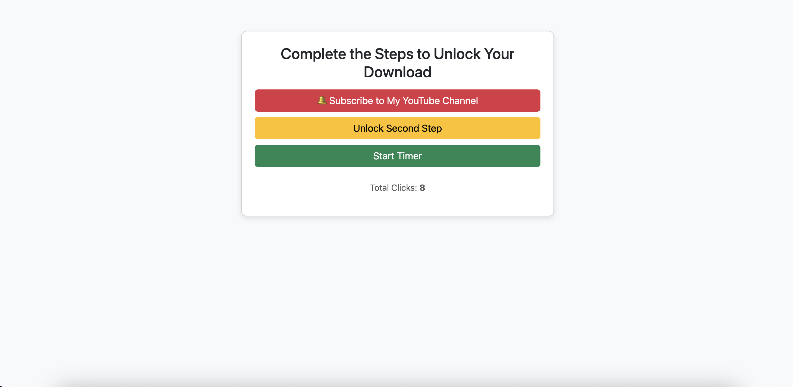
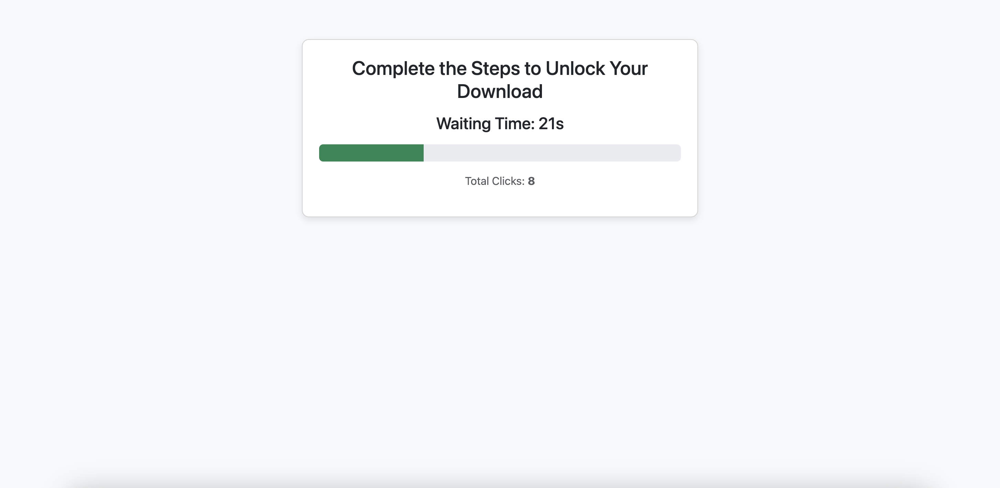
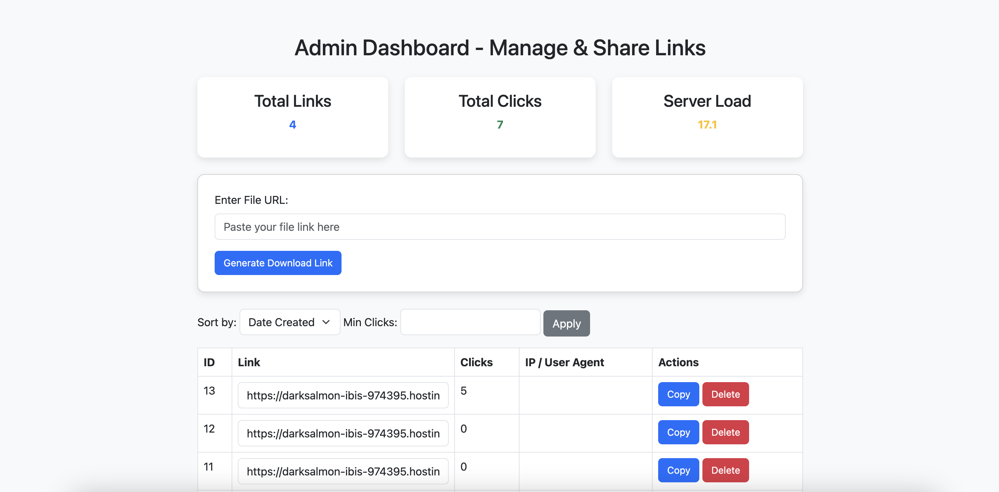

# 🚀 File Sharing and Link Management System


## 📌 About the Project
This is a **simple and efficient file-sharing system** that allows users to create short links for file downloads. It includes an **admin panel** to manage links, track clicks, and delete expired links.

---

## 🎯 Features
✅ **Short URL Generation** – Generate short links for downloadable files.  
✅ **Click Tracking** – Monitor how many times a link has been accessed.  
✅ **Admin Panel** – Manage all shared links and track statistics.  
✅ **Download Timer & Steps** – Users must complete steps before accessing the download.  
✅ **Ad Monetization** – Integrated with Adsterra banners for revenue generation.  
✅ **Simple & Clean UI** – Built with Bootstrap 5 for a modern, responsive design.  

---

## 📂 Project Structure
```
📦 Project Folder
 ├── 📜 index.php      # Frontend for file download and click tracking
 ├── 📜 admin.php      # Admin panel for managing links
 ├── 📜 database.sql   # Database structure (import into MySQL)
```

---

## 🛠️ Installation Guide
### 🔹 1️⃣ Clone the Repository
```bash
  git clone https://github.com/Rohit-Sangwan/FileSharingWebsite.git
  cd FileSharingWebsite
```

### 🔹 2️⃣ Set Up Database
- Import the `database.sql` file into your MySQL database.
- Database configuration is already managed within `index.php` and `admin.php`, no additional setup is required.

### 🔹 3️⃣ Run the Project
- Upload files to your **web server** (Hostinger, cPanel, or local server like XAMPP).
- Open the browser and visit:
  - **Frontend (Download Page)** → `https://yourdomain.com/index.php?code=example`
  - **Admin Panel** → `https://yourdomain.com/admin.php`

---

## 🔒 Security Recommendations
🛑 **Protect `admin.php` with authentication.**
🛑 **Use environment variables for database credentials.**
🛑 **Sanitize user inputs to prevent SQL Injection & XSS.**

---

## 🎨 UI Preview

### 📌 **Frontend (Download Page)**
 


### 📌 **Admin Panel**


---

## 📜 License
This project is licensed under the **MIT License**.

---

### 🚀 Created with ❤️ by **Rohit Sangwan (HaryanviDeveloper)**

